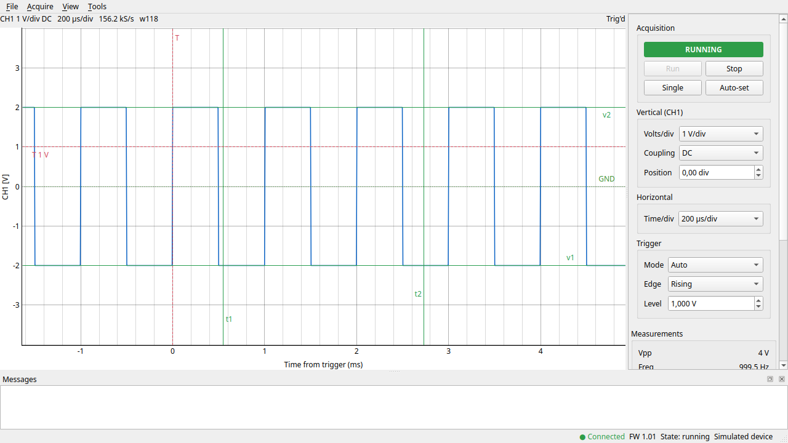
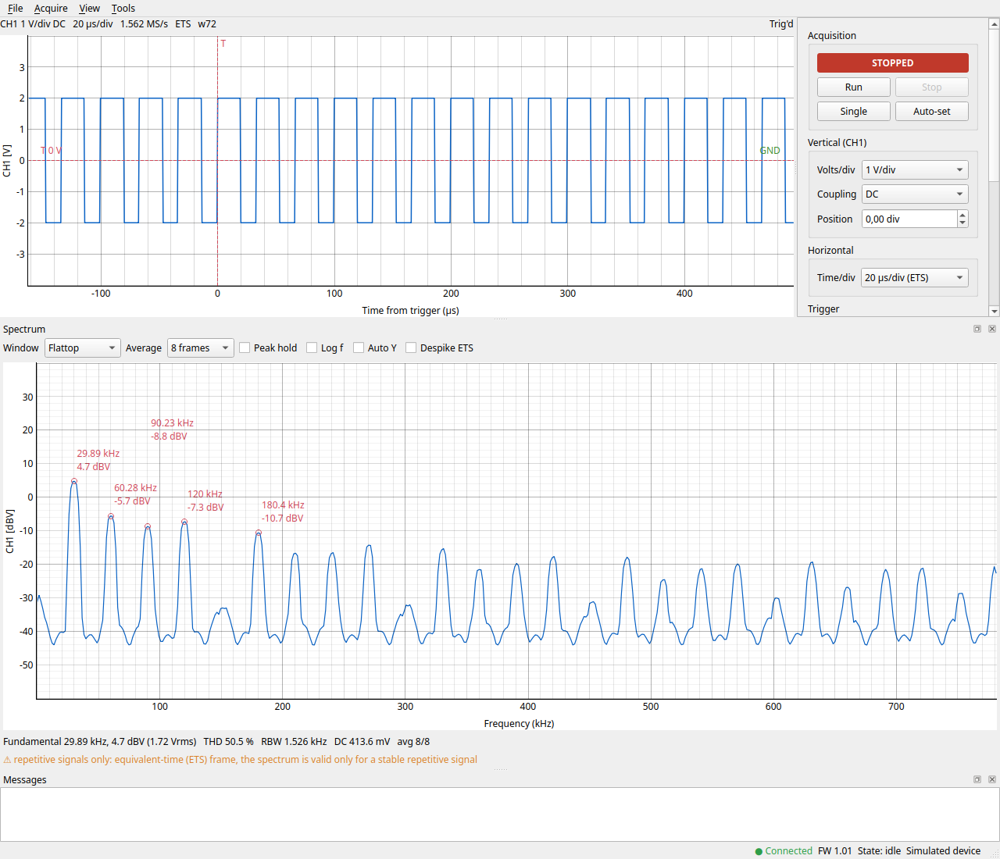

# openedu09

Open-source driver, GUI and MCP server for the **Whadda WSEDU09** (formerly Velleman EDU09)
USB PC oscilloscope kit. Runs on Linux and Windows (Python 3.12+), with a simulator for
hardware-free use.

[](https://github.com/BonBear/openedu09/actions/workflows/ci.yml)
[](LICENSE)
[](https://www.python.org/)



*The GUI running against the built-in simulator (`--simulate`).*



*View > Spectrum (Ctrl+F): flat-top window, 8-frame average, peak labels, THD and the ETS note
(simulated 30 kHz square wave, 60 % duty, ETS timebase).*

**Naming:** the project is called `openedu09`, the Python import package is `edu09`, and the
commands are `edu09-gui`, `edu09-mcp`, `edu09-calibrate`, `edu09-gain` and `edu09-probe`.

## Features

- **Driver library** (`edu09.Scope`): configure, single shot, continuous run, volts calibrated per
  unit; 15 timebases from 500 ms/div to 10 us/div (50/20/10 us use equivalent-time sampling);
  AUTO / NORMAL / off trigger with rising or falling edge; six ranges, 0.1 to 5 V/div.
- **GUI** (`edu09-gui`, PySide6 + pyqtgraph): live trace, cursors, measurements, CSV export,
  auto-set, spectrum analyzer, calibration wizard, optional built-in MCP server.
- **MCP server** (`edu09-mcp`): lets an AI agent configure the scope, acquire, measure, view the
  spectrum and export waveforms, over stdio or streamable HTTP.
- **Calibration wizard** (GUI, `edu09-calibrate`, MCP `calibration_*` tools): calibrate your own
  unit with a multimeter and the DC sources you have (batteries, USB 5 V, a bench supply):
  zero, optional RV1 trimmer adjustment, per-range gain on both sides of ground, verify.
- **Spectrum analyzer** (GUI, MCP `spectrum`, `edu09.analysis.spectrum`): 1024-sample FFT in
  Vrms/dBV with five windows, peaks, THD, averaging, and aliasing/ETS/clipping warnings.
- **Simulator** (`--simulate`): everything works without hardware.
- **Safety**: one process owns the device at a time (file lock); calibration is opt-in and needs
  the input disconnected; `edu09-probe` blocks unknown opcodes.

## Quick start

```bash
git clone https://github.com/BonBear/openedu09.git && cd openedu09
python3 -m venv .venv && . .venv/bin/activate
pip install -e '.[gui]'
```

- **Windows:** use `py -3.12 -m venv .venv` and `.venv\Scripts\activate` (Python 3.12 or 3.13
  only, no driver needed).
- **Linux:** install the udev rule once, and `libxcb-cursor0` for the GUI on X11:

  ```bash
  sh packaging/linux/install-udev.sh        # uses sudo; then replug the scope
  sudo apt install libxcb-cursor0           # Debian/Ubuntu, others: docs/install.md
  ```

Details and troubleshooting: [docs/install.md](docs/install.md). Then:

```bash
edu09-gui                               # GUI on the attached scope
edu09-gui --simulate "sine:1khz:2vpp"   # GUI without hardware
edu09-mcp                               # MCP server on stdio
edu09-mcp --simulate                    # MCP server on a simulated scope
edu09-mcp --http                        # MCP server on http://127.0.0.1:8765/mcp
```

## MCP with Claude Code

Add the server to `.mcp.json` (use the full path to the venv's executable; on Windows
`...\.venv\Scripts\edu09-mcp.exe`), or run `claude mcp add edu09 -- /path/to/openedu09/.venv/bin/edu09-mcp`:

```json
{
  "mcpServers": {
    "edu09": { "command": "/path/to/openedu09/.venv/bin/edu09-mcp" },
    "edu09-sim": {
      "command": "/path/to/openedu09/.venv/bin/edu09-mcp",
      "args": ["--simulate", "square:1khz:3vpp"]
    }
  }
}
```

Only one process can own the scope. If the GUI is open (start it with `edu09-gui --mcp-http`, or
Tools > MCP server), a plain stdio `edu09-mcp` detects it and forwards to the GUI automatically, so
the same config works either way. You can also connect straight to the GUI's endpoint:
`claude mcp add --transport http edu09-gui http://127.0.0.1:8765/mcp`.

Tools, options, the bridge, remote access (no authentication: trusted networks only) and
debug recording are described in [docs/usage.md](docs/usage.md#mcp-server-edu09-mcp).

## Calibration

Run the wizard once per unit (GUI Tools > Calibrate, or `edu09-calibrate`); you need a multimeter
and one or more DC sources.

1. Turn the board trimmer **RV1** to its **middle** position (first time only).
2. **Zero** with the input disconnected.
3. Optional **trimmer step**: a 1.5 V battery at 0.5 V/div; turn RV1 until the live reading
   matches the multimeter.
4. **Per-range gain** steps with the voltages you have, then **save** (a backup is made) and **verify**.

```bash
edu09-calibrate --plan-only --fixed 1.5@10%,rev,label=AA --fixed 5,label=USB   # what you can cover
edu09-calibrate --fixed 1.5@10%,rev,label=AA --fixed 5,label=USB --trimmer
```

Details, sources, the 5 V/div range and the file format: [docs/usage.md](docs/usage.md#calibration).

## Safety

- Max input **30 V** (AC + DC), input impedance 100 kOhm (vendor manual). The driver cannot
  protect the hardware from over-voltage; the calibration wizard asks for at most 15 V by default.
- The calibration's zero step needs the input **disconnected**. Only swap the leads of
  **floating** sources (batteries, isolated supplies), never of a source that shares ground with
  the PC.
- Only one program can use the scope at a time; the second one gets a "device busy" message
  naming the owner. Do not run the vendor software at the same time.

## Status and limitations

Alpha (0.1.0, released 2026-10-25). Firmware **1.01** of the WSEDU09/EDU09 is what was verified.

- **Verified on real hardware:** Linux and Windows (Python 3.12) with a hardware test suite, the
  GUI, the MCP server and bridge, the calibration wizard (including the RV1 trim and the 5 V/div
  range with a 25 V source) and the spectrum analyzer (on a 555 square wave).
  The protocol is documented in [docs/protocol.md](docs/protocol.md).
- **Untested:** macOS, other firmware versions, other Whadda/Velleman scopes. Single channel (CH1) only.
- **Vertical gain:** an uncalibrated unit reads 0.4-2.6 % high, and large negative deflections (more
  than ~4 div below ground at 0.2/0.5 V/div) up to ~6 % too large. The wizard measures and
  corrects both per unit (verify within ~0.6 % on the development unit). Without a calibration
  file, typical offsets and no gain correction are used, and the scope is shown as "Uncalibrated"
  (GUI status bar, MCP `get_status`). The 5 V/div range needs a 20-30 V reference
  (`--max-volts 25`).
- **ETS** (50/20/10 us/div) needs a repetitive, triggered signal; frames show a few isolated
  outlier samples (View > Despike).
- A readout timeout at GUI startup was seen once and has not been reproduced; if it happens, run
  with `--record FILE` and report it.

## Development

```bash
pip install -e '.[gui,dev]'
ruff check . && ruff format --check . && mypy && pytest -q
```

Hardware tests, safety rules and how to contribute captures: [CONTRIBUTING.md](CONTRIBUTING.md).
Security reports: [SECURITY.md](SECURITY.md). Changes: [CHANGELOG.md](CHANGELOG.md). Design
documents: [docs/specs/](docs/specs/).

## How it was built

The wire protocol was reverse engineered from the vendor software for the purpose of
interoperability, then confirmed with captures from a real device. The code was written with a
team of AI coding agents (see [AGENTS.md](AGENTS.md)) under human direction and review.

## License

[MIT](LICENSE), copyright (c) 2026 Björn Sjölén.

## Disclaimer

This project is independent. It is **not affiliated with or endorsed by Whadda or Velleman**.
"Whadda", "Velleman", "WSEDU09" and "EDU09" are trademarks of their respective owners. No vendor
software, firmware, documentation or other vendor files are included in this repository. Protocol
knowledge was obtained for interoperability purposes. Use at your own risk; the authors accept no
liability for damage to hardware or equipment.
